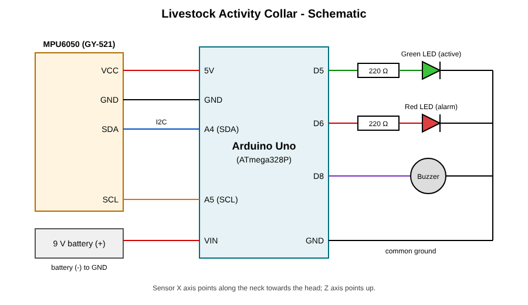
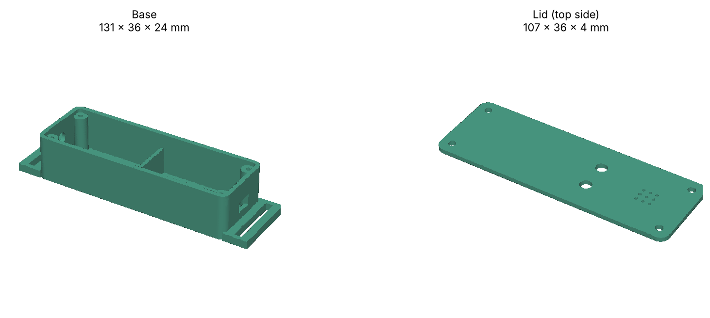
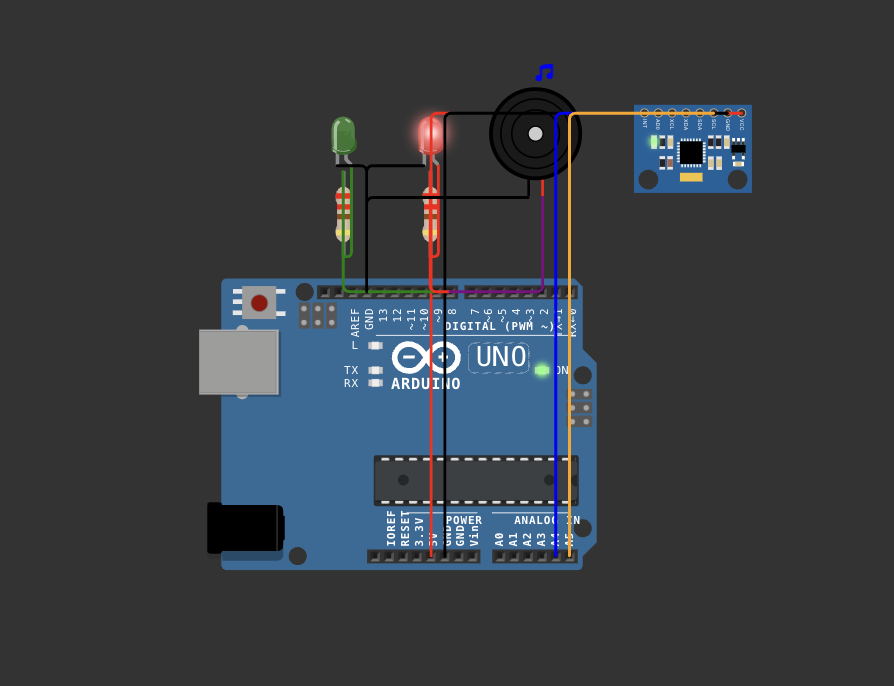

# Livestock Activity Collar 🐄

**ELT.123 Electronic Components and Circuits — Project Bank #25 (Smart Agri)**
**Author:** Nazar Smatov · **Supervisor:** Tauheed Khan · Ala-Too International University, 2026

A low-cost collar that a cow, sheep or horse wears on its neck. An MPU6050 accelerometer measures neck movement, and an Arduino classifies what the animal is doing every 4 seconds — **resting, ruminating (chewing the cud), grazing or walking**. The collar logs the result, reports how the animal's time is split between these activities, and raises an LED + buzzer alarm when the animal has not moved for too long.

| Schematic | 3D-printed collar case |
|---|---|
|  |  |

> 🎥 **Video demonstration:** _link will be added here_
> 📄 **Proposal and analysis:** [`docs/PROPOSAL_ANALYSIS.pdf`](docs/PROPOSAL_ANALYSIS.pdf)

---

## 1. Purpose

A healthy animal follows a stable daily routine: it grazes, ruminates, walks and rests for roughly the same number of hours every day. When it becomes sick, lame or is close to giving birth, this routine changes — it eats and ruminates less and lies down more. A farmer with a large herd on open pasture cannot watch every animal, so these changes are noticed late.

**Research question (from the Project Bank):** *Can a 3-axis accelerometer classify cattle behaviours using a low-power decision tree?*

The collar answers this with a decision tree that is small enough to run on an 8-bit Arduino Uno (2 kB RAM) in real time, without a PC or the cloud.

**Applications:** early illness detection (less rumination and grazing), heat detection (more walking), calving alert (restlessness, then long lying), pasture management (grazing time per day).

## 2. How it works

```
MPU6050 ──I2C──> Arduino ──> 20 Hz samples ──> 4 s window ──> 3 features ──> decision tree ──> LEDs, buzzer, CSV log
```

1. **Sampling:** acceleration on X, Y, Z is read 20 times per second (±2 g range, 10 Hz low-pass filter).
2. **Features** over each 4-second window (80 samples):
   - **Intensity** — standard deviation of the acceleration magnitude |a|. Gravity is constant, so this measures only the animal's own movement.
   - **Head-down angle** — from the average direction of gravity: θ = atan2(−aₓ, √(a_y² + a_z²)).
   - **Rhythm** — the highest normalised autocorrelation of |a| at lags for 0.77–1.67 Hz. Chewing the cud is weak but very regular (about one chew per second), so it gives a high rhythm value.
3. **Decision tree:**

   ```
   intensity < 0.05 g ?
   |-- yes: intensity > 0.012 g and rhythm > 0.5 ?
   |        |-- yes: RUMINATING
   |        `-- no:  RESTING
   `-- no:  head-down angle > 30° ?
            |-- yes: GRAZING
            `-- no:  WALKING
   ```

4. **Outputs:**
   - Green LED — on while the animal is active (anything except RESTING).
   - Red LED + buzzer — inactivity alarm when the animal has been RESTING without a break for longer than the alarm time (30 s for the demo, several hours on a real animal).
   - Red LED blinking fast — sensor fault (e.g. a loose I2C wire). The firmware keeps trying and recovers by itself.
   - Serial CSV log + a "time budget" line once per minute.

## 3. Hardware

### Components

| Part | Qty | Notes |
|---|---|---|
| Arduino Uno R3 (or Nano for the wearable case) | 1 | ATmega328P, 5 V |
| MPU6050 module (GY-521) | 1 | 3-axis accelerometer + gyroscope, I2C address 0x68 |
| Green LED, red LED (5 mm) | 1 + 1 | |
| 220 Ω resistor | 2 | (5 V − 2 V) / 220 Ω ≈ 14 mA per LED |
| Piezo buzzer | 1 | driven at 2 kHz |
| 9 V battery + snap connector | 1 | to VIN |
| Toggle switch (6 mm) | 1 | optional, in series with battery + |
| Perfboard 50 × 30 mm, jumper wires | — | for the cased version |

### Wiring

| Arduino pin | Connected to |
|---|---|
| 5V / GND | MPU6050 VCC / GND |
| A4 (SDA) / A5 (SCL) | MPU6050 SDA / SCL |
| D5 | 220 Ω → green LED → GND |
| D6 | 220 Ω → red LED → GND |
| D8 | Buzzer (+), buzzer (−) → GND |
| VIN / GND | 9 V battery (+) through the switch / battery (−) |

The pins are the same on the Uno and the Nano. Full schematic: [`docs/images/schematic.png`](docs/images/schematic.png) ([SVG](docs/images/schematic.svg)).

**Sensor orientation matters:** mount the MPU6050 so that its **X axis points along the neck towards the head** and Z points up. In the 3D case this direction is marked by an arrow on the floor.

### 3D-printed enclosure

[`cad/collar_enclosure.py`](cad/collar_enclosure.py) is a parametric model (all sizes are variables at the top of the file). It produces:

| File | Description |
|---|---|
| [`cad/collar_case_base.stl`](cad/collar_case_base.stl) | 131 × 36 × 24 mm. 9 V battery bay, electronics bay for Nano + GY-521 on perfboard, 4 screw posts, USB opening, switch hole, two slotted tabs for a 30 mm collar strap |
| [`cad/collar_case_lid.stl`](cad/collar_case_lid.stl) | Lid with holes for both LEDs and the buzzer, fixed with 4 × M3 screws |

Print settings: PLA or PETG (PETG is better outdoors), 0.2 mm layers, 20 % infill, no supports; print the lid flat side down. To change and regenerate the model:

```bash
pip install manifold3d trimesh matplotlib
python cad/collar_enclosure.py
```

## 4. Photos

<!-- Add photos to docs/photos/ and they will appear here, e.g.:


-->
_Photos of the assembled prototype are in [`docs/photos/`](docs/photos)._

Wokwi simulation (red LED and buzzer = inactivity alarm):



## 5. Setup and usage

### On real hardware

1. Assemble the circuit as in the wiring table.
2. Install the [Arduino IDE](https://www.arduino.cc/en/software). No extra libraries are needed — only the built-in `Wire` library.
3. Open `firmware/livestock_collar/livestock_collar.ino` (keep `activity.h` in the same folder).
4. Select **Tools → Board → Arduino Uno** (or Nano) and the correct port, then **Upload**.
5. Open **Tools → Serial Monitor** at **9600 baud**.
6. Test: hold the sensor still → `RESTING`; move it very gently and regularly up and down about once per second → `RUMINATING` (small movements only — a strong shake counts as walking); tilt it forward more than 30° and shake it → `GRAZING`; shake it with the sensor level → `WALKING`. Keep it still for 30 s → red LED and buzzer.

### In the Wokwi simulator

1. Create a new Arduino Uno project at <https://wokwi.com>.
2. Paste `livestock_collar.ino` into `sketch.ino`, add `activity.h` as a new file, and replace `diagram.json` with [`simulation/diagram.json`](simulation/diagram.json).
3. Start the simulation and click the MPU6050 to change the acceleration. Wokwi holds the values constant, so the collar reports `RESTING` and after 30 s the alarm switches on. Changing a value during a window produces movement and switches the alarm off.

### Classifier test on a PC

```bash
g++ -O2 -o test_activity test/test_activity.cpp && ./test_activity
```

The test generates 250 random 4-second windows per activity (random head angle, movement amplitude and frequency) and prints the mean features and the confusion matrix. It exits with an error if the accuracy is below 95 %.

### Whole firmware on a PC

`test/firmware_sim/` runs the unchanged sketch with a simulated MPU6050 (walking → ruminating → resting with alarm → sensor unplugged → grazing):

```bash
cp firmware/livestock_collar/livestock_collar.ino /tmp/sketch.cpp
g++ -O1 -include test/firmware_sim/Arduino.h -Itest/firmware_sim -Ifirmware/livestock_collar \
    test/firmware_sim/sim_main.cpp /tmp/sketch.cpp -o firmware_sim && ./firmware_sim
```

### Adjusting

All thresholds are at the top of [`activity.h`](firmware/livestock_collar/activity.h); the alarm time `INACTIVITY_ALERT_MS` is at the top of the sketch. Set it to several hours (e.g. `4UL * 3600000UL`) for real use.

## 6. Output format

One CSV line per 4-second window; lines starting with `#` are comments, so the log opens directly in Excel or pandas:

```
time_s,activity,intensity_g,head_angle_deg,rhythm,temp_c,alert
4,WALKING,0.255,5.0,1.01,25.0,0
24,RUMINATING,0.023,10.0,0.93,25.0,0
44,RESTING,0.006,5.1,0.18,25.0,0
# time budget: RESTING 20 s (33%) RUMINATING 20 s (33%) GRAZING 0 s (0%) WALKING 20 s (33%)
72,RESTING,0.005,5.0,0.19,25.0,1
93,GRAZING,0.125,49.9,0.81,25.0,0
```

## 7. Results

| Goal | Result |
|---|---|
| Read the MPU6050 over I2C without libraries | ✅ Done, with chip-ID check and automatic recovery after a wiring fault |
| Classify behaviour on the microcontroller with a low-power decision tree | ✅ 4 classes; the classifier needs ~350 bytes of RAM and runs on an 8-bit Uno |
| Rumination detection | ✅ Added with the rhythm (autocorrelation) feature |
| Inactivity alarm (LED + buzzer) and CSV logging | ✅ Done |
| Classifier test | ✅ 1000 / 1000 synthetic windows correct |
| 3D-printable wearable case | ✅ Designed (STL) |
| Edge Impulse model trained on real animal data | ❌ Not done — no labelled data from real animals |
| LoRa wireless logging | ❌ Not done — no LoRa module available; Serial logging is used instead |

The 100 % result is on **synthetic** signals: it proves the algorithm works as designed, not its accuracy on a real animal. A full discussion of achieved and not achieved goals and of future improvements is in [`docs/PROPOSAL_ANALYSIS.pdf`](docs/PROPOSAL_ANALYSIS.pdf).

## 8. Repository structure

```
livestock-activity-collar/
├── firmware/livestock_collar/
│   ├── livestock_collar.ino   # Arduino sketch: sensor, timing, LEDs, buzzer, logging
│   └── activity.h             # features + decision tree (plain C++, also used by the PC test)
├── test/
│   ├── test_activity.cpp      # PC test of the classifier with synthetic signals
│   └── firmware_sim/          # runs the whole sketch on a PC with a simulated sensor
├── simulation/diagram.json    # Wokwi circuit
├── cad/                       # parametric enclosure model and STL files
├── docs/
│   ├── PROPOSAL_ANALYSIS.md/.pdf   # original proposal + analysis of outcomes
│   ├── images/                # schematic, Wokwi screenshot, enclosure render
│   ├── photos/                # photos of the prototype
│   └── midterm/               # midterm progress report and presentation
└── README.md
```

## 9. Contributions

This is an **individual project** by **Nazar Smatov**: idea, circuit, firmware, testing, enclosure, documentation and video.

**Tools used:** Arduino IDE, Wokwi simulator, g++, Python (manifold3d, trimesh, matplotlib) for CAD. An AI assistant (Claude) was used for code review and for drafting parts of the code and documentation; all of it was checked, tested and is understood by the author.

## 10. References

1. InvenSense, *MPU-6000 and MPU-6050 Product Specification*, Rev. 3.4.
2. InvenSense, *MPU-6000 and MPU-6050 Register Map and Descriptions*, Rev. 4.2.
3. Arduino, *Arduino Uno Rev3 documentation*, <https://docs.arduino.cc/hardware/uno-rev3>.
4. Project Bank ECC 2026, project #25 "Livestock Activity Collar".
