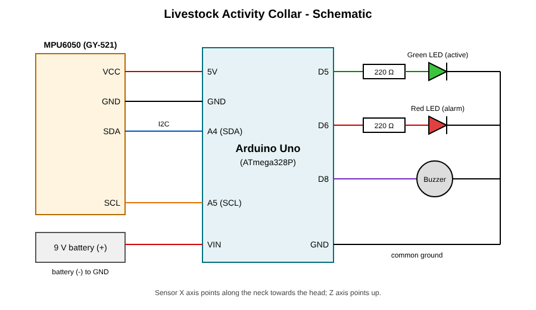

# Livestock Activity Collar

**Course:** ELT.123 Electronic Components and Circuits — Midterm Project Progress Report

| | |
|---|---|
| **Title** | Livestock Activity Collar |
| **Name** | _[your name]_ |
| **Supervisor** | _[supervisor name]_ |
| **Application** | Precision livestock farming: automatic monitoring of animal behaviour and early detection of illness |
| **Date** | 13 November 2026 |

---

## 1. Introduction

A healthy cow, sheep or horse follows a stable daily routine: it grazes for several hours, walks between pasture and water, and rests. When an animal is sick, injured or about to give birth, this routine changes — it usually moves and eats less. A farmer with a large herd on open pasture cannot watch every animal, so these changes are often noticed late.

The **Livestock Activity Collar** is a small Arduino-based device worn on the animal's neck. It measures neck movement with an accelerometer, classifies what the animal is doing (**resting**, **grazing** or **walking**), logs the result, and raises an alarm when the animal has been inactive for too long.

**Objectives**

1. Read 3-axis acceleration from an MPU6050 sensor over I2C.
2. Classify activity into three classes on the microcontroller itself.
3. Log activity, movement intensity, head angle and temperature as CSV.
4. Signal an inactivity alarm with an LED and a buzzer.

**Real-time applications**

- **Health monitoring** — a drop in activity or grazing time is an early sign of lameness, fever or digestive problems.
- **Heat (estrus) detection** — cows in heat walk noticeably more than usual, which helps choose the time for insemination.
- **Calving alert** — restlessness followed by long lying periods indicates that calving is near.
- **Pasture management** — the grazing time per day shows whether the pasture provides enough feed.
- **Theft and predator warning** — unusual running at night can trigger an alarm.

## 2. Methods

### 2.1 Components

| Component | Key specifications | Role |
|---|---|---|
| Arduino Uno R3 (ATmega328P) | 5 V logic, 16 MHz, 32 kB flash, 2 kB RAM, I2C on A4/A5 | Reads the sensor, runs the classifier, drives outputs |
| MPU6050 module (GY-521) | 3-axis accelerometer + 3-axis gyroscope, 16-bit, range ±2 g (16384 LSB/g), I2C address 0x68, built-in temperature sensor, 3.3–5 V supply via onboard regulator | Measures neck movement and orientation |
| Green LED + 220 Ω resistor | ~2 V forward voltage, ~14 mA at 5 V | Shows that the animal is active |
| Red LED + 220 Ω resistor | ~2 V forward voltage, ~14 mA at 5 V | Inactivity alarm |
| Piezo buzzer | 5 V, driven at 2 kHz | Audible alarm |
| 9 V battery | Connected to VIN | Portable power |

Resistor value: (5 V − 2 V) / 220 Ω ≈ 14 mA, safely below the 20 mA limit of an Arduino pin.

### 2.2 Schematic

| Arduino pin | Connected to |
|---|---|
| 5V | MPU6050 VCC |
| GND | MPU6050 GND, LED cathodes, buzzer (−) |
| A4 (SDA) | MPU6050 SDA |
| A5 (SCL) | MPU6050 SCL |
| D5 | 220 Ω → green LED anode |
| D6 | 220 Ω → red LED anode |
| D8 | Buzzer (+) |
| VIN | 9 V battery (+) |

The sensor is mounted so that its X axis points along the neck towards the head and its Z axis points up.

### 2.3 Working description

1. **Sampling.** Every 50 ms (20 Hz) the Arduino reads the acceleration on X, Y and Z and converts the raw values to g.
2. **Windowing.** 40 samples form a 2-second window.
3. **Feature 1 — movement intensity.** For each sample the magnitude |a| = √(ax² + ay² + az²) is calculated. When the animal is still, |a| stays at 1 g (gravity only). The standard deviation of |a| over the window therefore measures how strongly the animal is moving.
4. **Feature 2 — head-down angle.** The mean acceleration over the window gives the direction of gravity, from which the neck angle below horizontal is calculated: θ = atan2(−ax, √(ay² + az²)).
5. **Classification.**

   | Condition | Activity |
   |---|---|
   | intensity < 0.05 g | RESTING |
   | intensity ≥ 0.05 g and θ > 30° | GRAZING (moving with head down) |
   | intensity ≥ 0.05 g and θ ≤ 30° | WALKING |

6. **Outputs.** The green LED is on while the animal is active. If the animal rests without a break for longer than the alarm time (30 s for demonstration, several hours in real use), the red LED turns on and the buzzer beeps.
7. **Logging.** One CSV line per window is sent over Serial at 9600 baud:
   `time_s,activity,intensity_g,head_angle_deg,temp_c,alert`

### 2.4 Software

The classifier is in `firmware/livestock_collar/activity.h`, written in plain C++ without Arduino functions. This allows the same code to run on the Arduino and in a PC test. The sketch `livestock_collar.ino` handles the sensor, timing and outputs, and uses only the built-in `Wire` library.

## 3. Results

### 3.1 Current progress

| Item | Status |
|---|---|
| Circuit design and schematic | Done |
| Firmware (sensor reading, classifier, alarm, logging) | Written |
| Classifier test on PC with synthetic signals | Done — passed |
| Wokwi simulation circuit (`simulation/diagram.json`) | Prepared |
| Upload to a real Arduino and test on hardware | **Not done yet** |
| Test on a real animal, threshold tuning | **Not done yet** |

### 3.2 Classifier test

The classifier was tested on a PC (`test/test_activity.cpp`) with **synthetic** accelerometer signals: 200 windows of 2 s for each activity. Resting was modelled as sensor noise with a level head, grazing as irregular movement with the head 50° down, and walking as a 2 Hz step rhythm with a level head.

Mean features:

| True activity | Intensity [g] | Head angle [°] |
|---|---|---|
| RESTING | 0.006 | 5.0 |
| GRAZING | 0.118 | 50.0 |
| WALKING | 0.249 | 5.0 |

Confusion matrix (rows = true, columns = predicted):

| | RESTING | GRAZING | WALKING |
|---|---|---|---|
| **RESTING** | 200 | 0 | 0 |
| **GRAZING** | 0 | 200 | 0 |
| **WALKING** | 0 | 0 | 200 |

All 600 windows were classified correctly. This result shows that the algorithm and thresholds work as designed on clean, well-separated signals. It does **not** show the accuracy on a real animal, where signals are noisier and the collar can rotate on the neck.

### 3.3 Limitations and next steps

- Build the circuit on a breadboard and confirm the firmware on real hardware.
- Record data from a real animal and tune the two thresholds.
- Add wireless transmission (HC-05 Bluetooth or LoRa) so the farmer receives the data remotely.
- Add an SD card for long-term logging and use sleep modes to extend battery life.
- Move to an Arduino Nano or Pro Mini in a waterproof case for a wearable size.

## References

1. InvenSense, *MPU-6000 and MPU-6050 Product Specification*, Rev. 3.4.
2. InvenSense, *MPU-6000 and MPU-6050 Register Map and Descriptions*, Rev. 4.2.
3. Arduino, *Arduino Uno Rev3 documentation*, https://docs.arduino.cc/hardware/uno-rev3
